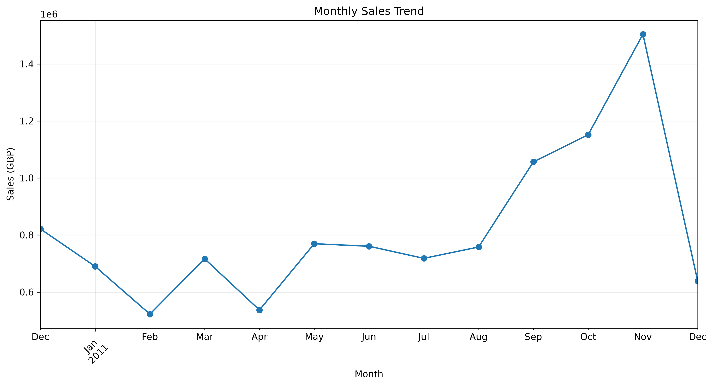
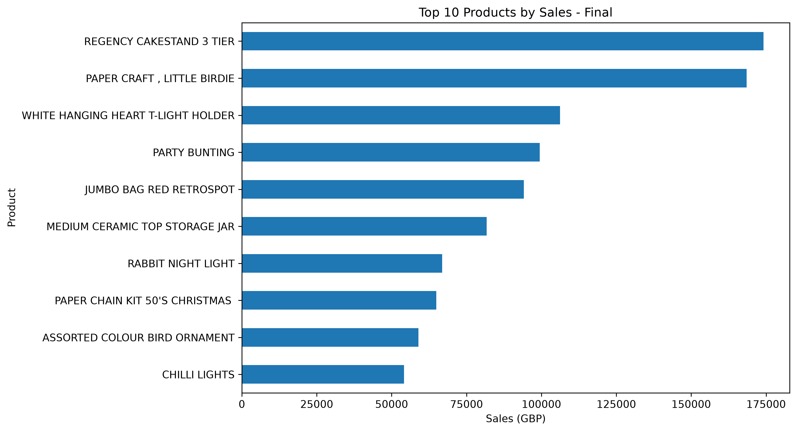
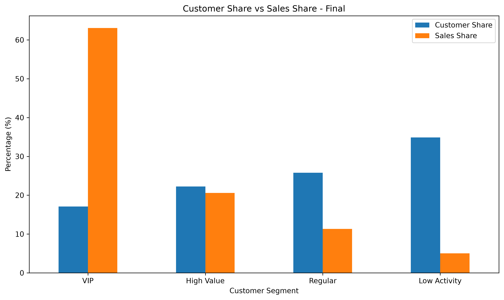
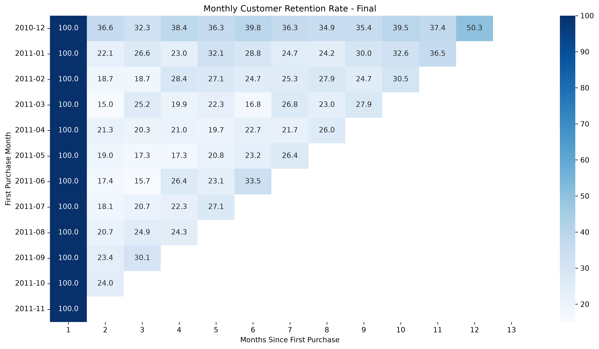

# Online Retail Sales Analysis & RFM Customer Segmentation

### Python 기반 온라인 쇼핑몰 매출 분석 및 고객 세분화를 통한 마케팅 전략 제안

## 1. 프로젝트 개요

온라인 쇼핑몰의 거래 데이터를 활용하여 매출 변화의 특징을 파악하고, 고객의 구매 행동을 분석하여 데이터 기반 마케팅 전략을 제안하는 프로젝트입니다.

단순한 매출 시각화에 그치지 않고, **매출 변화 요인 분석, RFM 고객 세분화, 재구매 행동 분석, 고객 유지율 분석**을 통해 기업의 의사결정에 활용할 수 있는 인사이트를 도출하는 것을 목표로 했습니다.

**핵심 분석 질문**

- 월별 매출은 어떻게 변화하며, 주문 수와 객단가는 어떤 관계가 있는가?
- 어떤 상품이 높은 매출을 발생시키는가?
- 어떤 고객군이 매출에 가장 크게 기여하는가?
- 재구매 고객의 구매 행동에는 어떤 특징이 있는가?
- 고객의 재구매와 유지를 높이기 위해 어떤 전략이 필요한가?

## 2. 데이터 및 분석 환경

| 항목 | 내용 |
|---|---|
| 데이터 | UCI Online Retail Dataset |
| 분석 기간 | 2010.12.01 ~ 2011.12.09 |
| 원본 데이터 | 541,909행, 8개 변수 |
| 분석 대상 | 영국 기반 온라인 소매 거래 데이터 |
| 분석 도구 | Python, Jupyter Notebook |
| 주요 라이브러리 | Pandas, NumPy, Matplotlib, Seaborn |
| 주요 분석 방법 | 매출 분석, RFM 분석, 재구매 분석, 코호트 분석 |

### 데이터 전처리

- 중복 거래 5,268건 제거
- 취소 거래 및 수량·가격 이상값 검토
- 정상 판매 거래 524,878건 확보
- 고객 식별 정보가 존재하는 거래를 활용하여 고객 분석 수행
- 배송비, 수수료 등 비상품성 항목을 구분하여 상품 매출 분석에 반영

## 3. 월별 매출 분석

월별 매출과 주문 수, 평균 주문금액(AOV)을 비교하여 매출 변화의 특징을 분석했습니다.

**주요 결과**

- 2011년 9월부터 11월까지 매출 증가 추세 확인
- 2011년 11월 매출 약 £1.50M으로 분석 기간 내 최고치 기록
- 2011년 11월 매출은 전월 대비 30.63% 증가
- 같은 기간 주문 수는 35.74% 증가한 반면, 평균 주문금액은 3.76% 감소

**인사이트**

2011년 11월 매출 증가는 객단가 상승보다는 주문 수 증가와 관련이 큰 것으로 나타났습니다.

따라서 매출 변화를 분석할 때 총매출뿐 아니라 주문 수와 객단가를 함께 살펴볼 필요가 있습니다.

## 4. 상품별 매출 분석

비상품성 거래를 제외하고 상품별 매출을 집계하여 매출 상위 10개 상품을 분석했습니다.

**주요 결과**

- REGENCY CAKESTAND 3 TIER
- PAPER CRAFT, LITTLE BIRDIE
- WHITE HANGING HEART T-LIGHT HOLDER
- PARTY BUNTING
- JUMBO BAG RED RETROSPOT

장식용 소품, 생활용품, 파티용품 등이 매출 상위 상품에 포함되었습니다.

**전략 제안**

매출 상위 상품의 판매 추이를 지속적으로 관리하고, 관련 상품의 교차판매 가능성을 검토할 수 있습니다.

단, 실제 상품 간 연관성을 확인하기 위해서는 장바구니 분석 등 추가 분석이 필요합니다.

## 5. RFM 고객 세분화

RFM 분석은 고객을 다음 세 가지 기준으로 평가하는 방법입니다.

- **Recency:** 최근 구매 후 경과일
- **Frequency:** 구매 빈도
- **Monetary:** 누적 구매금액

각 지표에 1~5점을 부여하고 합산 점수를 기반으로 고객을 네 개 그룹으로 분류했습니다.

동일한 구매 빈도와 최근 구매 경과일에 동일한 점수가 부여되도록 점수 산정 기준을 보완했습니다.

### 고객 등급별 분석 결과

| 고객 등급 | 고객 수 | 고객 비중 | 매출 비중 |
|---|---:|---:|---:|
| VIP | 741 | 17.08% | 63.07% |
| High Value | 965 | 22.25% | 20.59% |
| Regular | 1,119 | 25.80% | 11.30% |
| Low Activity | 1,513 | 34.88% | 5.04% |

**핵심 인사이트**

전체 고객의 17.08%인 VIP 고객이 고객 식별 가능 매출의 63.07%를 차지했습니다.

또한 VIP와 High Value 고객을 합치면 전체 고객의 약 39.33%가 매출의 83.66%를 차지했습니다.

이는 고객별 구매 실적의 차이가 크며, 주요 고객군의 유지 관리가 중요하다는 점을 보여줍니다.

단, RFM 분류 기준 자체에 구매금액이 포함되어 있으므로 매출 집중도 해석에는 주의가 필요합니다.

## 6. 재구매 및 구매 주기 분석

### 재구매 고객 분석

| 지표 | 결과 |
|---|---:|
| 전체 고객 수 | 4,338명 |
| 재구매 고객 수 | 2,845명 |
| 재구매 고객 비율 | 65.58% |
| 재구매 고객 매출 비중 | 93.09% |

재구매 고객이 고객 식별 가능 매출의 대부분을 차지하는 것으로 나타났습니다.

### 구매 주기 분석

고객별 평균 구매 간격을 계산하여 구매 행동의 차이를 분석했습니다.

- 재구매 고객의 평균 구매 간격: 72.65일
- 고객별 평균 구매 간격 중앙값: 53.46일
- 구매 실적 우수 고객 중 90일 이상 미구매 고객: 115명
- 개인별 평균 구매 주기 대비 장기간 미구매 고객: 162명

**인사이트**

모든 고객에게 동일한 미구매 기간을 적용하기보다는 고객별 구매 주기를 고려한 재구매 유도 전략을 검토할 수 있습니다.

## 7. 코호트 고객 유지율 분석

고객을 첫 구매 월에 따라 구분하고, 이후 월별 재구매 비율을 분석했습니다.

**주요 결과**

- 2011년 1~10월 첫 구매 코호트의 다음 달 재구매율은 15~24% 범위
- 첫 구매 다음 달에 구매하지 않는 고객이 상당수 존재
- 일부 고객은 구매하지 않은 기간 이후 다시 구매하는 패턴을 보임

2011년 12월은 관측 기간이 불완전하여 최종 히트맵에서 제외했습니다.

**인사이트**

첫 구매 고객을 재구매 고객으로 전환하기 위한 초기 고객 관리 전략이 필요할 수 있습니다.

## 8. 데이터 기반 마케팅 전략

### 전략 1. VIP 고객 유지 강화

**분석 근거:** VIP 고객 741명이 고객 식별 가능 매출의 63.07%를 차지

**제안 방안**
- 우수 고객 대상 맞춤형 혜택
- 구매 이력 기반 상품 추천
- VIP 고객의 구매 주기 변화 모니터링

### 전략 2. 장기간 미구매 고객 재활성화

**분석 근거:** 구매 실적이 우수하지만 장기간 구매하지 않은 고객 115명 확인

**제안 방안**
- 개인별 구매 주기를 활용한 재구매 알림
- 고객별 선호 상품 기반 프로모션
- 장기간 미구매 우수 고객 대상 재활성화 캠페인

### 전략 3. 신규 고객의 두 번째 구매 유도

**분석 근거:** 첫 구매 다음 달 재구매율이 15~24% 범위로 나타남

**제안 방안**
- 첫 구매 이후 후속 상품 추천
- 두 번째 구매 혜택 제공
- 신규 고객 대상 CRM 캠페인

위 전략은 분석 결과를 기반으로 한 제안이며, 실제 효과는 A/B 테스트 등을 통해 검증해야 합니다.

## 9. 분석 한계 및 향후 개선 방향

- 데이터가 약 1년간의 거래를 포함하므로 장기적인 고객 행동 분석에는 한계가 있습니다.
- 고객 식별 정보가 없는 거래는 고객 세분화 분석에서 제외했습니다.
- RFM 고객 등급은 분석자가 설정한 점수 구간과 분류 기준에 따라 달라질 수 있습니다.
- 코호트 분석에서 데이터 수집 시작 이전의 구매 이력은 확인할 수 없습니다.
- 마케팅 전략의 실제 성과는 실험을 통해 추가 검증해야 합니다.

향후에는 장바구니 분석, 고객 이탈 예측 모델, 고객 생애가치(CLV) 분석 등으로 프로젝트를 확장할 수 있습니다.

## 10. 프로젝트 파일 구성

| 파일 | 설명 |
|---|---|
| `01_data_preprocessing.ipynb` | 데이터 탐색 및 전처리 |
| `02_sales_analysis.ipynb` | 월별 매출 및 상품별 매출 분석 |
| `03_RFM_analysis.ipynb` | RFM 고객 세분화 및 재구매 분석 |
| `04_cohort_analysis.ipynb` | 코호트 고객 유지율 분석 |
| `images/` | 최종 분석 시각화 자료 |

## 11. 프로젝트를 통해 얻은 역량

- Python과 Pandas를 활용한 거래 데이터 전처리
- 매출, 주문 수, 객단가를 활용한 비즈니스 지표 분석
- RFM 기반 고객 세분화 및 고객별 매출 기여도 분석
- 고객별 구매 주기와 코호트 유지율 분석
- 분석 결과를 비즈니스 의사결정 및 마케팅 전략으로 연결하는 역량

---

**Data Source:** UCI Machine Learning Repository — Online Retail Dataset

https://archive.ics.uci.edu/dataset/352/online+retail
